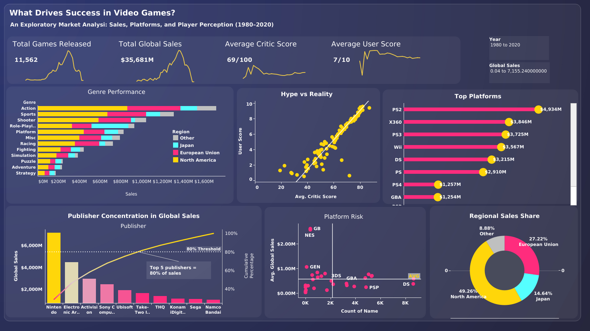

# What Drives Success in Video Games?

An exploratory market analysis of video game sales, platforms, and player perception (1980-2020), built as an interactive Tableau dashboard.



**[View the live interactive dashboard on Tableau Public](https://public.tableau.com/views/VideoGameSalesDashboard_17917323738970/Dashboard1?:language=en-US&:sid=&:redirect=auth&:display_count=n&:origin=viz_share_link)**

---

## Questions this dashboard answers

1. Which genres and regions generate the most sales?
2. Do critics and players agree on what makes a good game?
3. Which platforms dominated, and which were risky bets?
4. How concentrated is the industry among publishers?
5. How are sales split across regions?

## Dataset at a glance

| Metric | Value |
|---|---|
| Games released | 11,562 |
| Total global sales | $35,681M |
| Average critic score | 69 / 100 |
| Average user score | 7 / 10 |
| Time span | 1980-2020 |


## Key findings

- **Action leads genre sales**, followed by Sports and Shooter. North America is the largest contributor in nearly every genre.
- **Critics and users broadly agree.** The Hype vs Reality scatter shows a strong positive relationship between critic and user scores, with a handful of outliers where players disagree sharply with critics.
- **PS2 is the top platform** by global sales (~$4.9B), ahead of X360, PS3, and Wii.
- **The industry is concentrated.** Nintendo alone is far ahead, and a small group of top publishers accounts for the large majority of global sales.
- **North America drives about half of global sales** (49.3%), then the European Union (27.2%), Japan (14.6%), and other regions (8.9%).
- **Platform risk varies widely.** Some platforms (e.g. GB, NES) have a high average sales per game but few titles, while others have many titles and lower averages.

## Dashboard components

| Section | Chart type | Purpose |
|---|---|---|
| KPI cards | Number + sparkline | Headline metrics over time |
| Genre Performance | Stacked bar | Sales by genre, split by region |
| Hype vs Reality | Scatter + trend line | Critic score vs user score |
| Top Platforms | Lollipop bar | Global sales by platform |
| Publisher Concentration | Pareto chart | Cumulative share of sales by publisher |
| Platform Risk | Scatter | Avg sales per game vs number of games |
| Regional Sales Share | Donut | Region split of global sales |

Interactive filters: **Year** range and **Global Sales** range.

## Tools

- Tableau Public


## Repository structure

```
.
├── README.md
├── dashboard.png        
├── .gitignore            
└── data/       
```

## How to explore it

1. Open the [live dashboard](https://public.tableau.com/views/VideoGameSalesDashboard_17917323738970/Dashboard1?:language=en-US&:sid=&:redirect=auth&:display_count=n&:origin=viz_share_link).
2. Use the Year and Global Sales sliders to narrow the view.
3. Click a genre, platform, or publisher to cross-filter the other charts.

## Limitations

- Critic and user scores are only available for a subset of games, so score-based charts do not cover all 11,562 titles.
- Sales figures are historical estimates and may not include digital-only sales.

## Author
Ola Al-Dalahmeh
